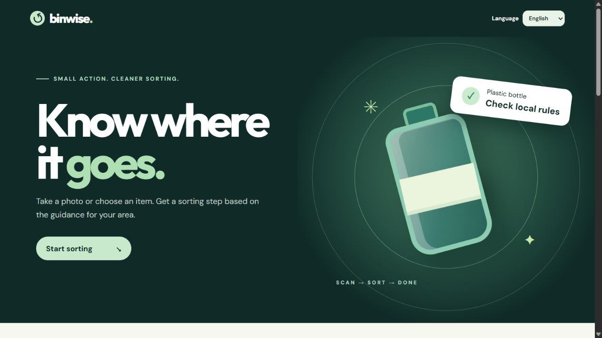
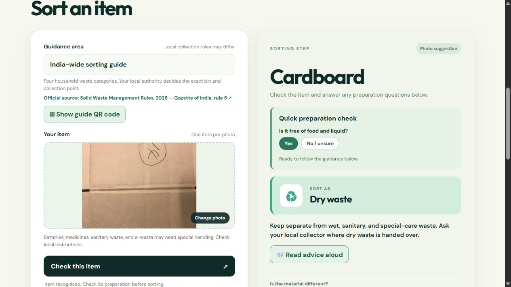
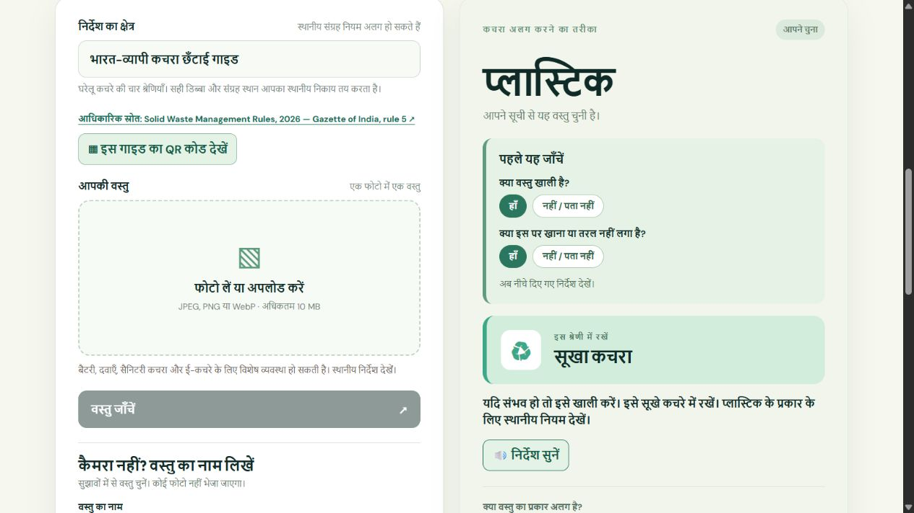

# BinWise

**Neural Storm 2026 · GP-05 Smart Waste Segregation System**

BinWise helps someone sort one waste item. A photo is classified into one of six material groups, then a separate rules profile maps that material to a waste stream or local bin and a practical preparation step. When the model is uncertain or detects a category outside those six groups, the app withholds automatic bin advice. Users can also choose "Something else" themselves.

> **Development timing:** This is a pre-event prototype created before the official November 2–4, 2026 build window. Check the hackathon rules before using any of it in an entry. Do not claim it was built during the event.

## Team

- Team name: **BinWise** (solo entry)
- Participant name: **Hridya Jain**

## Problem and approach

Waste items often reach the wrong bin because the material is hard to recognise or local collection rules are unclear. BinWise combines:

1. A Python image classifier: ImageNet-pretrained MobileNetV3-Small features, then a calibrated six-class material model selected on validation data from logistic regression and an RBF support vector machine.
2. Configurable, location-specific bin rules stored in `config/locations.json`.
3. A confirmation step when model confidence or the top-two margin is low.
4. A supported-item guard trained to decline selected out-of-scope categories. In the India profile, a user can manually identify food/organics, sanitary waste, or special-care waste and receive sourced stream guidance.
5. A mobile-friendly web interface with camera capture or photo upload. It asks for a retake when a photo is very dark, blurry, or too small.
6. A short preparation check before dry-waste or recycling advice: the user confirms that the item is empty when relevant and free of food and liquid. When the answer is no or unsure, BinWise withholds the bin suggestion and asks for a local check.
7. A typed-item fallback for a small, explicit catalog of common items. It uses the same location rules without uploading an image or running the model.
8. Hindi guidance for the India-wide profile, plus browser read-aloud for available guidance.
9. A printable QR entry point for sourced rules profiles. Its link selects the profile automatically. The India-wide QR card explicitly says it is not a physical-bin map; illustrative campus and office profiles cannot produce QR cards.
10. Minimal answer feedback: people can mark advice correct, report a different material, or flag a local-rule difference. The app database stores no photo or user identifier, and feedback is not treated as verified ground truth.
11. One-tap examples for plastic bottles, cardboard boxes, food scraps, and batteries; each uses the same checked text-lookup path.

The India-wide profile is based on the [Solid Waste Management Rules, 2026, rule 5](https://egazette.gov.in/WriteReadData/2026/269620.pdf): wet, dry, sanitary, and special-care waste are separate streams. It is **source-segregation guidance, not a map of physical bins or pickup points**. Local authorities determine the exact handover arrangement. The campus and office profiles remain illustrative examples. A camera cannot determine every material, contamination status, or local restriction.

The photo-quality thresholds are heuristics tested on sample images, not validated on real phone photos; a clean but low-detail image may be rejected. The typed route accepts only the displayed catalog and its known aliases, so an unmatched item receives no guess. Hindi sorting instructions are available for the India-wide profile; sample-site instructions remain in English. Read-aloud uses the browser's speech synthesis and depends on its installed voices.

The public screen shows the sourced India-wide guide. The campus and office profiles are illustrative and appear only when you open `/?demo=1`; this lets judges compare profiles without presenting example rules as real collection points. Event details, technical metrics, and AI-tool disclosure live in this README rather than the sorting screen.

## Tech stack

- Python 3.12, FastAPI, Uvicorn
- PyTorch and torchvision MobileNetV3-Small
- scikit-learn logistic regression
- Pillow, NumPy
- Segno for QR generation; SQLite for local feedback counts
- HTML, CSS, vanilla JavaScript

## Setup and run

Create a Python 3.12 environment and install dependencies:

```bash
python -m venv .venv
# Windows: .venv\Scripts\activate
# macOS/Linux: source .venv/bin/activate
pip install -r requirements.txt
```

For a CPU-only installation, install PyTorch and torchvision from the [official CPU wheel index](https://download.pytorch.org/whl/cpu) before the `requirements.txt` step.

Trained model files are included in `models/`. To reproduce training, download both datasets (the RealWaste archive is about 689 MB):

```bash
python scripts/download_data.py --realwaste
python scripts/train.py --realwaste-zip data/realwaste.zip
python scripts/train_guard.py --realwaste-zip data/realwaste.zip
```

Start the web app:

```bash
uvicorn app:app --host 0.0.0.0 --port 8000
```

Open `http://localhost:8000`. For a phone on the same Wi-Fi, open `http://YOUR-COMPUTER-IP:8000` (subject to firewall settings). The `/api/health` route reports whether model files are present.

The **Show guide QR code** button appears for the sourced India-wide guide. A QR code opened on another device needs a reachable base URL. On a public deployment, set `BINWISE_PUBLIC_URL` to that deployment's origin (for example, `https://example.org`). For a phone on the same Wi-Fi, use the computer's LAN address. Without this setting, BinWise uses the request origin; localhost QR cards cannot be downloaded or printed because they would not open on another device. The QR link is `/?site=india-2026`, which selects the profile on arrival. To enable QR for another collection point, first verify its rules and set `qr_shareable` in `config/locations.json`; sample profiles are disabled.

Feedback is saved to `data/feedback.sqlite3` by default. Set `BINWISE_FEEDBACK_DB` to a writable persistent path on a hosted deployment; many free hosts discard local files on restart. The database stores profile, shown material, route (model/manual/text), feedback choice, and optional corrected material. It stores no photo, name, or IP address. Review counts with `python scripts/summarize_feedback.py` or pass `--db PATH`. Self-reported feedback can guide fixes but does not measure model accuracy.

The repository also includes a Dockerfile. It serves the app on port `7860` for container hosting.

## Model evaluation

Training uses fixed stratified 70/15/15 train, validation, and test splits for TrashNet and RealWaste (seed 42). The model type and confirmation threshold are selected using validation data. The training script writes the held-out results, class report, confusion matrix, and threshold to `models/metrics.json`.

On **919 held-out images** across both datasets, the current model reached **87.27% accuracy** and **0.871 macro F1**. Accuracy was **87.37%** on TrashNet's test split and **87.20%** on RealWaste's test split. With the confirmation rule, the model gave an automatic answer for **92.27%** of test images, and **91.63%** of those answers were correct. These are dataset results, not field-test results.

The separate supported-item guard was trained using RealWaste food organics, vegetation, and textile trash as unsupported examples. On a held-out set of **175 images from those three categories**, it rejected **89.14%**. When combined with the original classifier, the rate of automatic bin advice on those unsupported images fell from **90.29% to 8.57%**. Automatic advice on the 919 supported test images fell from **92.27% to 90.21%**. See `models/guard_metrics.json`. This guard has **not** been validated on batteries, electronics, sanitary waste, or arbitrary new objects. The "Something else" manual path and local-rule warning remain necessary.

**Important limitation:** TrashNet photos mostly show isolated objects on simple backgrounds; RealWaste photos come from landfill settings. Neither is an actual phone-camera test at a collection point. For a hackathon claim about real-world use, collect new phone photos during the event, label them independently, and report that result separately. Do not present validation or training images as unseen tests.

## Demo and screenshots

These screenshots show the current public screen. The cardboard photo is from TrashNet and shows an actual model result. It is not a phone-camera field test. The Hindi screen uses a one-tap text example.







The repository also retains the earlier unsupported-item screenshot as a UI example; it uses a dataset image and is not an independent field test.

[Watch the 95-second cinematic product demo](media/binwise-cinematic-demo.mp4). It follows a short sorting problem, then shows large, steady captures of the real BinWise interface, and ends with a clean brand card. Gentle scene fades and low original music support the narration. It covers the photo-quality retake, an actual cardboard model result using a TrashNet dataset photo, preparation checks, the no-bin-guess path, typed lookup, wet and special-care guidance, Hindi, feedback, and a clearly labelled sample campus profile. The video QR opens the official Gazette rules source; BinWise's own guide QR needs a reachable deployed or LAN app URL. The animated opening and closing are illustrations, and the app captures are staged states rather than a continuous live recording. The editing structure was inspired by the [Before I Call demo](https://youtu.be/Sw112GoVYqo); no reference footage is used.

[Watch the approximately 100-second comic feature tour](media/binwise-comic-tour-100.mp4). It has five animated GIF characters: [bottle](media/bottle-bounce-v2.gif), [battery](media/battery-diva-v2.gif), [Detective Cardboard](media/cardboard-detective.gif), [dancing banana peel](media/banana-dancer.gif), and [blur gremlin](media/blur-gremlin.gif). A short problem story leads into actual browser captures of the BinWise interface for the preparation check, typed lookup, food and battery guidance, Hindi guidance, and feedback. The calm narration, gentle music, compact captions, and clean fades explain photo scanning, retakes, uncertainty, the sourced India-wide guide, and local rules. The visible, scannable video QR opens the official Gazette rules source; BinWise's own guide QR requires a reachable deployed or LAN app URL. Animated scenes and staged browser captures are clearly distinct from a continuous live walkthrough.

The [60-second comic cut](media/binwise-comic-tour.mp4), [92-second feature tour](media/binwise-feature-tour.mp4), and [23-second concept animation](media/binwise-concept.mp4) are also included. For judging, record a separate live walkthrough of the actual app, including a camera scan, a location change, and a low-confidence confirmation.

The concept animation can be rendered again from the included original scene illustrations with `python scripts/render_cartoon.py` after installing `imageio-ffmpeg` (in addition to the app requirements). To refresh the real browser captures, install Playwright and run `python scripts/capture_demo_states.py` on Windows with Chrome or Edge installed. For the cinematic video, install `edge-tts`, generate narration with `python scripts/narrate_comic_tour_100_neural.py --script scripts/cinematic_narration.txt --output-directory ../../work/cinematic-voice --rate +12%`, then run `python scripts/render_cinematic_demo.py`. The comic tour uses the 16-line script in `scripts/comic_tour_100_narration.txt`: run `python scripts/narrate_comic_tour_100_neural.py --output-directory ../../work/comic-voice-100-neural`, then `python scripts/render_comic_tour_100.py`. For an offline Windows comic-tour fallback, run `powershell -File scripts/narrate_comic_tour_100.ps1 -OutputDirectory ../../work/comic-voice-100-neural` before rendering. The short comic and earlier feature tours use their matching scripts. The render scripts use Windows fonts.

Suggested live demonstration: scan a common item, answer the preparation questions, and show the resulting guidance. Show a dark or blurry photo being rejected, then choose a common item from the one-tap examples. Switch to Hindi and press **Read advice aloud**. Open the QR card and explain that it selects the sourced guide; use a deployed or LAN URL for a phone scan. Send one test correction and run `scripts/summarize_feedback.py`. Open `/?demo=1` only when explaining how an illustrative location profile changes the advice, and label it as sample data. Include a difficult item that triggers a confirmation request. The cartoon animation is a concept illustration, not evidence of these working flows.

## Sorting pilot

`pilot/` contains a ten-item, counterbalanced pilot kit using the four India-wide source-segregation streams. The schedule generator assigns app and no-app conditions equally across six anonymous participants; the analysis script computes descriptive accuracy and time. **No people have been tested yet, so there are no pilot outcome claims.** Read [the pilot protocol](pilot/README.md) before collecting observations.

```bash
python scripts/prepare_pilot.py --participants 6
# After entering real responses in pilot/sessions.csv:
python scripts/analyze_pilot.py
```

## AI tool disclosure

OpenAI Codex assisted with product planning, code generation, testing, documentation, and video assembly for this pre-event prototype. OpenAI's built-in image generation created the three cartoon scene illustrations and the five transparent waste characters for the comic tours. Microsoft Edge's Neerja neural text-to-speech generated the cinematic and comic tour narration from the included scripts. The image model uses torchvision's pretrained ImageNet weights and is trained for material classification using TrashNet and RealWaste images. Update this section with all AI tools actually used by the team during the hackathon.

## Data credit

TrashNet: [garythung/trashnet](https://github.com/garythung/trashnet). RealWaste: [UCI Machine Learning Repository, dataset 908](https://archive.ics.uci.edu/dataset/908/realwaste). Dataset files are downloaded by the script and are not included in this repository. Confirm each dataset's applicable terms before redistribution or commercial use.
